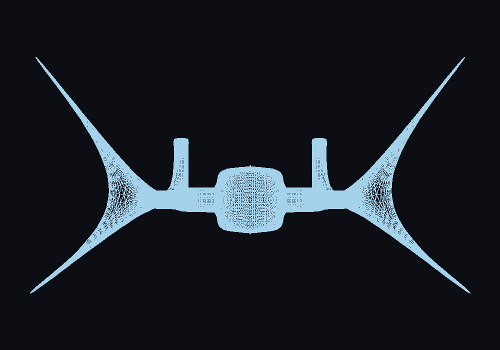

# Laboratorio 4: Carga de modelos OBJ

Proyecto 1, parte 1 — Gráficas por Computadora, Universidad del Valle de Guatemala.

Carga la nave del laboratorio de Blender y dibuja el contorno de sus 116,480 triángulos mediante un renderer por software en Rust.



## Requisitos del laboratorio

- Leer el archivo OBJ y almacenar sus vértices e índices.
- Recorrer los índices de tres en tres y recuperar los vértices de cada triángulo.
- Dibujar cada triángulo con `triangle`, sus tres líneas con Bresenham y sus píxeles en el framebuffer, adaptando el dibujo de `filling-triangles`.
- Usar X/Y, escala uniforme y traslación para centrar el modelo y mantenerlo visible con al menos 60 píxeles de margen.
- Incluir el código fuente, el OBJ y una captura visible en este README.

Raylib crea la ventana, permite escribir píxeles en una imagen y presenta esa imagen como textura. La carga OBJ, las líneas y los triángulos se implementan en el proyecto; no se utilizan funciones automáticas para cargar o dibujar modelos 3D.

## Compilar y ejecutar

Se necesitan Rust y Cargo, CMake, un compilador C/C++, Clang/libclang y las bibliotecas de desarrollo de OpenGL y X11 (Xrandr, Xinerama, Xcursor y Xi en Linux). La ejecución requiere una sesión gráfica; en Wayland se utiliza XWayland. Cargo descarga y compila Raylib durante la primera compilación.

Desde una terminal:

```bash
git clone https://github.com/sallco/lab4-modelo.git
cd lab4-modelo
cargo build --locked
cargo run --locked
```

La ventana mide 1000×700 píxeles. Presionar `Esc` o cerrar la ventana termina el programa. El OBJ se busca en `assets/nave1.obj` dentro del proyecto, sin depender del directorio desde el que se ejecute el binario.

## Controles de exploración

Mantener una tecla presionada modifica la vista de forma continua. La referencia de teclas también aparece en el título de la ventana.

| Teclas | Acción |
| --- | --- |
| `←` / `→` | Girar alrededor del eje Y. |
| `↑` / `↓` | Girar alrededor del eje X. |
| `Q` / `E` | Girar alrededor del eje Z. |
| `W` / `A` / `S` / `D` | Mover el modelo arriba, izquierda, abajo y derecha. |
| `+` / `=` / `-` | Acercar o alejar; también admite `+` y `-` del teclado numérico. |
| `R` | Restaurar la orientación, el zoom y el centro iniciales. |
| `Esc` | Salir. |

El zoom permite entre 0.25× y 4×. Al ampliar o desplazar es posible salir del encuadre; `R` devuelve el modelo completo a la ventana.

Para generar nuevamente la captura de la vista inicial y salir:

```bash
cargo run --locked -- --screenshot docs/modelo.png
```

## Funcionamiento y archivos

```text
OBJ → vértices e índices → triángulos → líneas → píxeles → pantalla
```

| Archivo | Responsabilidad |
| --- | --- |
| `assets/nave1.obj` | Nave original triangulada: 58,384 vértices y 349,440 índices. |
| `src/obj.rs` | Lectura de `v` y `f`, conversión de índices desde 1 a 0 y validación. |
| `src/renderer.rs` | Encuadre X/Y y recorrido de todos los triángulos por sus índices. |
| `src/triangle.rs` | Conexión de los tres lados de cada triángulo. |
| `src/line.rs` | Rasterización de líneas mediante Bresenham. |
| `src/framebuffer.rs` | Escritura de píxeles con límites de imagen. |
| `src/view.rs` | Rotaciones, zoom, desplazamiento y controles de teclado. |
| `src/main.rs` | Ventana, actualización de la vista y captura. |

El encuadre usa los vértices referenciados por las caras e invierte Y para la pantalla. La imagen se vuelve a rasterizar cuando los controles modifican la vista; mientras permanece quieta se reutiliza la textura.

El cargador admite caras trianguladas con índices positivos (`f 1 2 3`, `v/vt` o `v/vt/vn`); ignora texturas, normales y materiales. Rechaza caras sin triangular, índices inexistentes y coordenadas no finitas. La vista inicial utiliza X/Y; la exploración rota las coordenadas 3D antes de tomar X/Y para dibujar. Se mantiene una proyección sin perspectiva y sin ocultamiento de superficies: todas las aristas se superponen y la densidad de la malla hace que algunas zonas parezcan rellenas.

## Verificación

```bash
cargo test --locked
cargo clippy --locked --all-targets -- -D warnings
cargo fmt --check
```

Verificado en Linux con Rust 1.99.1 y Raylib para Rust 5.5.1: compilación, ejecución gráfica, doce pruebas y captura PNG. Las pruebas cubren el cargador, líneas, contornos, encuadre, recorrido de los 116,480 triángulos, rotaciones, zoom, desplazamiento y restauración de la vista. La captura mide 1000×700 y el modelo ocupa X=60–940 e Y=114–586, centrado y sin recortes.

La entrega corresponde al enlace de este repositorio con el código, el modelo y la captura incorporados.
